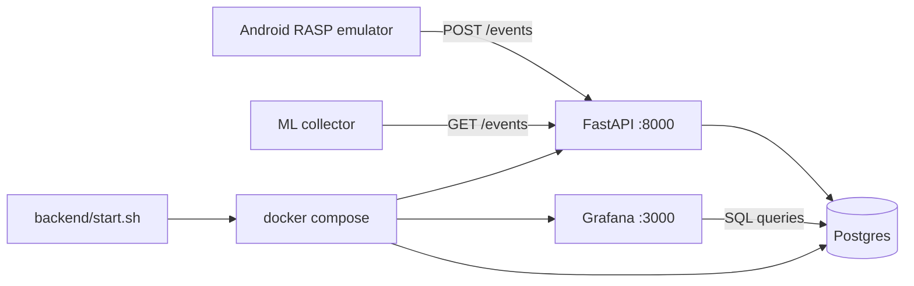

# Grafana RASP Dashboard Backend

## Overview

Create a new `backend/` stack (branch off `main`) with FastAPI webhook ingestion compatible with the Android RASP client, Postgres persistence, and a provisioned Grafana dashboard of real charts—not just tables—plus a one-shot bash script to run it all.

Work stays only under `backend/`. Commits happen in small steps after you approve each one.

## Context (from the repo)

- Android `Rasp.java` already POSTs ME-01..ME-15 events to `http://10.0.2.2:8000/events` and expects `{"action":"allow"}`.
- Prototype hook lives in `serverSide/testHook/src/app.py` (in-memory only). ML collector also `GET`s `/events`.
- A prior React/MUI SIEM UI exists on `origin/feat/threat-alert-dashboard` under `serverSide/threat-dashboard/` — **not used**. This feature uses **Grafana**, and all new code lives under root `backend/` only (no edits to Android, ML, or `serverSide/`).

## Architecture



**Defaults locked in:**

- Branch: `feat/grafana-rasp-dashboard` from `main`
- Stack: Docker Compose → **FastAPI + Postgres + Grafana**
- Port **8000** kept so the emulator and collector work without Android/ML code changes
- Grafana anon/admin local creds for FYP demo (`admin` / `admin`)
- Reuse the **threat classification ideas** from the old branch (debugger/root/integrity → alerts), rewritten inside `backend/`

## Target layout

```text
backend/
  PLAN.md                  # this plan
  start.sh                 # one command: up API + Postgres + Grafana
  docker-compose.yml
  README.md
  api/
    Dockerfile
    requirements.txt
    app/
      main.py
      db.py
      models.py
      schemas.py
      routers/events.py
      routers/health.py
      services/classify.py
      services/seed.py
  grafana/
    provisioning/datasources/datasource.yml
    provisioning/dashboards/dashboards.yml
    dashboards/rasp-siem.json
```

## Webhook contract (must match Android)

Keep the same envelope as `serverSide/testHook`:

- `POST /events` → validate `RaspEvent`, persist raw event, optionally create an **alert** row, return `{"action":"allow"}`
- `GET /events` → return stored events (collector-compatible; newest-first with a reasonable limit, e.g. last 5k)
- `GET /health` → liveness
- `POST /api/seed` → optional demo traffic so Grafana is never empty before the emulator runs

## Grafana: real panels (not a table dump)

Provision one **RASP SIEM Overview** dashboard with:

| Panel | Query idea |
|-------|------------|
| Stat: events last 15m | `COUNT(*)` on `events` |
| Stat: open critical alerts | alerts where `severity='critical'` |
| Time series: event rate by `event_type` | `date_trunc` + group by type |
| Donut: alert severity mix | group alerts by severity |
| Bar: top banking API paths | ME-10 `data->>'url_path'` |
| Time series: env threats | ME-11 / ME-14 / ME-15 detections over time |
| Stat: login failures | ME-06 / login_result failures |
| Timeline or bar: hot screens | ME-09 `component` |
| Table (secondary only): latest alerts | last 20 threats with reason |

Provisioning auto-loads the Postgres datasource + dashboard on first boot so opening `http://localhost:3000` shows charts immediately (seed data if needed).

## Commit workflow (small steps — ask before each commit)

Work only on the feature branch. After each step finishes, **stop and ask** to approve the commit message / confirm before committing.

1. **Branch + scaffold** — create `feat/grafana-rasp-dashboard`, empty `backend/` skeleton (`api/`, `grafana/`, compose stub, `.gitignore`).
   - Commit: `chore: scaffold backend folder for Grafana RASP stack`

2. **FastAPI webhook + Postgres models** — schemas, SQLAlchemy models (`events`, `alerts`), `POST/GET /events`, `GET /health`, Dockerfile + `requirements.txt`.
   - Commit: `feat: add FastAPI webhook that persists RASP events`

3. **Threat classification** — port/adapt classify rules (debugger attached, root/emulator detected, integrity failed, suspicious input) into `alerts`.
   - Commit: `feat: classify RASP risk signals into alerts`

4. **Docker Compose wiring** — Postgres + API services, env vars, volume for DB.
   - Commit: `chore: dockerize API and Postgres for local SIEM`

5. **Grafana provisioning + dashboard JSON** — datasource + multi-panel dashboard (charts above).
   - Commit: `feat: provision Grafana RASP SIEM dashboard with charts`

6. **Seed + start script + README** — `POST /api/seed`, `backend/start.sh` (`docker compose up --build -d` + wait/health + print URLs), docs for emulator (`10.0.2.2:8000`).
   - Commit: `chore: add start script, seed data, and backend README`

No PR unless asked; `main` is protected so the branch is for a PR later.

## How you run it (end state)

```bash
cd backend && ./start.sh
```

- API docs: `http://127.0.0.1:8000/docs`
- Grafana: `http://127.0.0.1:3000`
- Android emulator keeps posting to `10.0.2.2:8000/events` unchanged

## Out of scope

- Editing Android, `ML/`, or `serverSide/testHook`
- Replacing/merging the old React `threat-dashboard` branch
- Shipping the AndroLabServer Flask bank API inside this compose file (already separate on `:8888`)
